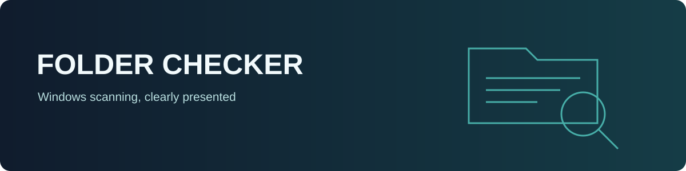
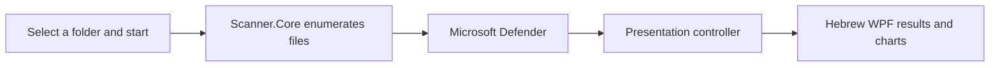

# Folder Checker

A Windows desktop folder scanner with a Hebrew WPF interface and Microsoft Defender integration.

[Try the demo](#try-the-demo) · [Features](#features) · [Requirements](#requirements) · [Build and run](#build-and-run) · [Architecture](#architecture) · [Verification and limitations](#verification-and-limitations)

## Try the demo

On Windows with .NET SDK 10.0.404 installed, open Command Prompt in this repository and run:

```cmd
build.cmd build
build.cmd demo
```

The demo uses simulated data; it does not scan files or perform treatment.

## How it works



The interface is in **Hebrew**, with right-to-left layouts. This repository contains application source and safe managed checks, rather than a separate antivirus engine or packaged binary release.

## Features

- Scan a selected local folder and its subfolders, with live progress and charts.
- Inspect findings, errors, incomplete coverage and technical details; export a JSON report to a new file.
- Recognize a successful Windows quarantine when bounded, run-scoped Defender evidence supports it. The original engine response remains visible; incomplete results are not relabeled as clean.
- Offer explicitly confirmed Recycle Bin handling only for eligible current-run findings.
- Explore a clearly labeled DEMO mode without scanning files or performing treatment.

**Folder-name shortcut:** explicitly selecting a folder named ALON BLUTRICH requests that the default browser open a fixed YouTube video. A nonmodal notice reports the dispatch; it does not confirm playback. Selecting an ordinary folder, refreshing the engine or resizing the window does not trigger that shortcut.

## Requirements

- Windows with Microsoft Defender available. Scanning depends on the installed Defender engine and its permissions.
- **.NET SDK 10.0.404**, including Windows desktop targeting support. The exact SDK is pinned in global.json.
- A normal interactive Windows desktop. The launcher uses software rendering for compatibility.

No account or subscription is required. The application does not itself upload files; Defender follows the user's Windows configuration. Reporting to Microsoft opens the official manual submission page, without sending a file or report.

## Build and run

Open Command Prompt in this repository after installing the required SDK:

    build.cmd build
    build.cmd test
    build.cmd demo

To use the real application:

    build.cmd run

For an SDK in a custom location, set its executable first, then use the same commands:

    set "DOTNET_EXE=C:\path\to\dotnet.exe"

Build output and local tool caches stay under .build. The script does not download an SDK/runtime or change system PATH, certificates or protection settings. The NuGet source list is empty; the projects use framework packs supplied by the SDK.

The test command runs managed checks with synthetic sessions and transcripts. It does not launch Defender, scan real files, open a browser or recycle files. The demo command opens simulated data; run opens the real interface, with scanning initiated by folder selection and Start.

## Architecture

- Scanner.Core: enumeration, Defender invocation, bounded diagnostics, evidence and guarded file actions.
- Scanner.Presentation: controller, run lifecycle, result projection and Windows treatment reconciliation.
- Scanner.Presentation.Wpf: WPF views and charts.
- Scanner.Wpf: desktop shell, visual scene and demo scenarios.
- Presentation.Checks: focused managed regression checks.

## Verification and limitations

The accepted application was exercised through its visible interface at 960×760 and 1280×900 in a 96-DPI Windows environment. A harmless standard antivirus test case confirmed the Windows-quarantine display path, including evidence arriving after the scan command returned. Clean-file scanning, repeat/cancel, details and JSON export were also checked.

Native recycling was verified separately on an owned benign marker. A real threat → application confirmation → recycle chain was **not** demonstrated: Windows quarantined the antivirus test fixture first. This does not establish complete malware detection.

Mixed-DPI behavior, exhaustive accessibility and WPF response times for 24,000 results were not measured. Decorative animation may stutter on some systems. A tested machine or scenario is not a compatibility or performance guarantee.

This public source export preserves the accepted product code. Public build/documentation files are separate from private development records. No automated CI status, binary release or license grant is asserted here.